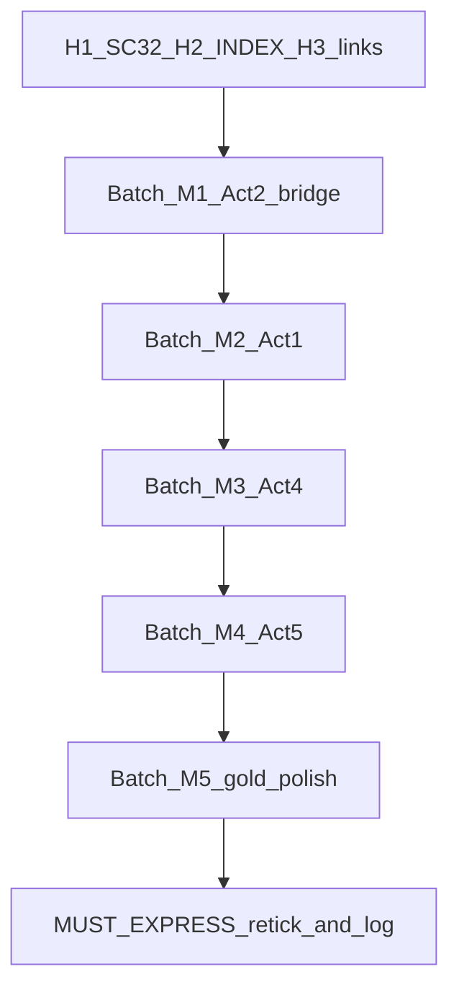

# Mid-Tier Expansion Pass — Plan (1A + Stay Inside Locks)

**Status:** Accepted approach (conversation lock)  
**Scope:** Expand lean Book 1 chapters to mid-tier prose density; fix continuity/docs hygiene; deepen story *within* existing scene cards and canon.  
**Out of scope:** Novel-length rewrite to LEN-1 (90–130k); structure surgery (new acts, reopened A-locks, SIDE-1b crown, Actium).

**Related:** [batch_bcd_screening.md](batch_bcd_screening.md) · [future_research.md](future_research.md) · [canon.md](canon.md) · [writing/CHAPTER_MAP.md](../writing/CHAPTER_MAP.md) · [writing/MUST_EXPRESS.md](../writing/MUST_EXPRESS.md)

---

## 1. Goals & non-goals

### Goals
1. Bring **lean / beat-sheet** chapters to **~500–900 prose words** each (scene-card count may push a chapter to ~1,000 if it holds 3 cards).
2. Preserve **Ides gold spine** (Ch 7, 9, 14–20) as the density ceiling for this pass — polish/compress there; do not bulk-expand unless a hole appears.
3. Close **real continuity gaps**: SC-32 missing; dossier INDEX broken paths.
4. Deepen story craft **inside** locked cards using the writing-book rubric below (desire, stakes, info asymmetry, consequence, voice).
5. Re-tick MUST_EXPRESS after expansion so ticks mean **dramatized behaviour**, not one-line presence.

### Soft length outcome
| Now | After 1A (est.) | LEN-1 (later) |
|-----|-----------------|---------------|
| ~15k prose words | ~35–50k | 90–130k |

1A is a **readable mid-draft**, not the final novel.

### Non-goals (do not reopen)
- NOTE-1 dual · DREAM-1 · CHOREO-1 · HOUSE-1 · FUNERAL-1 / EXIT-1 / CLEO-1 soft dates  
- SIDE-1b (keep **OPEN-0**) · SERIES-1 (end at Philippi) · AMB-1/2/3  
- POV-1 roster · VOICE-1 (close 3rd limited, past) · TONE-1 / HUMOR-1 dials  
- Full Latin VERIFY · Appian funeral-gesture VERIFY · full *MRR* · Actium plotting

---

## 2. Story thesis (deepen, do not reinvent)

Hold this as the single sentence every expanded scene must serve:

> Incomplete information and plural motives destroy a Republic that still believes speeches can outvote veterans, grain, and names on wills.

### Cross-cutting series promises (from `story/master_story_frame.md`)
1. Incomplete information is a weapon and a trap.  
2. Motives inside the conspiracy stay plural.  
3. Popular and military Rome outvote senatorial poetry.  
4. Fictional strands illuminate without overwriting anchors.  
5. Omens stay ambiguous.

### Consequence chains to *feel* on the page (not essay)
Prioritize dramatizing these chains when expanding lean chapters — each expansion should advance **one link**:

| Chain | Lean chapters that should carry more weight |
|-------|-----------------------------------------------|
| 1 Clemency → access | Ch 4 |
| 2 Honours → fear | Ch 6, 7 (already mid; light touch) |
| 3 Parthia clock | Ch 6, 8, 13 |
| 4 Ides cascade | Gold spine — polish only |
| 5 Will → name → army | Ch 21–22, 27 |
| 6 Spare Antony → funeral | Ch 9 (mid) → 15–19 — polish |
| 7 Letters vs mud | Ch 21, 25, 28 |
| 8 Liberty as tax | Ch 32 |
| 9 Proscription economy | Ch 30–31 |
| 10 Philippi info-death | Ch 33–34 |

### Character desires for expansion (McKee / Cron / Maass)
When expanding a POV scene, state privately in continuity notes (not in prose):

| POV | Conscious want | Unconscious need / wound | Mid-tier expansion focus |
|-----|----------------|--------------------------|--------------------------|
| Decimus | Keep Caesar’s favour *and* “save” the Republic | Fear of being only a tool | Ch 9, 13, 29 — loyalty as addiction |
| Brutus | Ancestral script / clean liberty | Money & hesitation contradict the brand | Ch 4, 8, 24, 32 |
| Cassius | Operational control; wound-pride | Need for a world that stays solvable | Ch 8, 32–33 |
| Antony | Soldier clarity; resources | Underestimates paper/boy | Ch 22, 27, 30 |
| Cicero | Words as weapons | Needs an army he will not admit | Ch 21, 25, **SC-32**, 31 |
| Octavian | Survive; claim name | Not destiny — learning cold | Ch 5, 22, 29 |
| F1 Nysa | Survive household weather | Need to know enough to live | Ch 1, 11–12, 23 |
| F2 Seius | Stay adjacent to power without committing | Cowardice as prudence | Ch 2, 10, 23, 30 |
| F3 Laberius | Land / pay | Love of paymaster ≠ love of ideology | Ch 3, 13, 28 |
| F4 Hordeonius | Solvency as virtue | SIDE-1 as ledger horror | Ch 2, 10, 18, 30 |

---

## 3. Craft-book rubric (mapped to this project)

Use these as **expansion checks**, not as a second bible that overrides canon. Each expanded scene must pass the relevant gates.

### A. Story engine (what happens and why we care)
| Book | Use in this pass |
|------|------------------|
| **Lisa Cron — *Wired for Story* / *Story Genius*** | Every scene: POV has a misbelief under pressure; reader tracks *what they think is true* vs *what is true*. Lean chapters fail this when they only report events. |
| **Robert McKee — *Story*** | Desire → conflict → gap → choice → new equilibrium. End scene when info state changes (already in SCENE_TEMPLATE). No “walk-and-talk summary.” |
| **Donald Maass — *Writing the Breakout Novel*** | Raise personal stakes beside public ones; micro-tension every page (status, debt, overhear). F1–F4 exist for this — use them in lean acts. |
| **James Scott Bell — *Plot & Structure*** | Respect act hinges already mapped: Lupercalia (Ch 7), GO (Ch 13), Ides (14–16), funeral (19), name (22), Mutina (27–28), Philippi (33–34). Expansion strengthens hinges, does not move them. |
| **Blake Snyder — *Save the Cat!*** | Use only as **checkpoint labels** on existing map (Theme Stated ≈ Ch 1–2 debt/liberty irony; Fun & Games ≈ recruitment Ch 8–10; Midpoint ≈ will/funeral; Dark Night ≈ proscriptions/Cicero; Finale ≈ Philippi). Do **not** force a Hollywood beat sheet over Roman chronology. |
| **Christopher Vogler — *The Writer’s Journey*** | Optional lens for **Octavian** and **Decimus** only (threshold / ordeal). Never cast Caesar as Mentor-who-knows or Octavian as Chosen One with destiny voiceovers. |

### B. Prose & scene craft (how it reads)
| Book | Use in this pass |
|------|------------------|
| **Stephen King — *On Writing*** | Cut explanation; prefer concrete nouns/verbs; 2nd draft = “less”; no writerly throat-clearing in lean expansions. |
| **Strunk & White — *Elements of Style*** | Omit needless words; prefer active voice; keep parallel structure in lists/ritual speech. |
| **William Zinsser — *On Writing Well*** | Clarity over ornate period pastiche; one idea per paragraph; trust the reader on politics. |
| **Steven Pinker — *The Sense of Style*** | Classic style: show the world as the POV sees it; avoid “zombie nouns” (the implementation of the assassination → the knives). |
| **Renni Browne — *Self-Editing for Fiction Writers*** | Show/tell balance; dialogue beats; resist RUE (resist urge to explain mysteries); proportion — don’t dump research. |
| **John Gardner — *The Art of Fiction*** | Maintain the vivid continuous dream; no anachronistic diction that wakes the reader (“data,” “destiny music,” meta-Shakespeare). Already a project ban — enforce on expansion. |
| **Brian Kiteley — *The 3 A.M. Epiphany*** | When stuck expanding a postcard beat, steal **one** constraint exercise (e.g. scene told only through overheard speech; only through money changing hands) — then normalize into VOICE-1. |

### C. Process & courage (how to work the pass)
| Book | Use in this pass |
|------|------------------|
| **Anne Lamott — *Bird by Bird*** | One scene card at a time; short assignments; shitty first expansion OK if canon-clean. |
| **Steven Pressfield — *The War of Art*** | Schedule batches; do not reopen SIDE-1b or Actium as Resistance. |
| **Annie Dillard — *The Writing Life* / Natalie Goldberg — *Writing Down the Bones*** | Timed freewrite *off-repo* for voice, then paste only what serves the card. |
| **Austin Kleon — *Steal Like an Artist*** | Steal **craft** from SAMPLE-1 / Spartacus bite / GRRM grey — not plot from Shakespeare or HBO. |
| **Ann Handley — *Everybody Writes*** | Continuity notes stay scannable; chapter headers stay consistent for collaborators. |

### D. Per-scene expansion checklist (print beside each lean chapter)
Before marking a chapter mid-tier done:

1. **Cron:** What does the POV wrongly believe at ENTER? What cracks by EXIT?  
2. **McKee:** What choice did they make that they cannot unmake?  
3. **Maass:** Where is the personal cost (shame, debt, body, love, status)?  
4. **Info:** Is there at least one wrong or late rumour (A3/A6)?  
5. **King/Zinsser:** Cut 10% after drafting the expansion.  
6. **Browne:** No mystery explained that MUST_EXPRESS / canon says keep open.  
7. **Gardner:** No modern wink; no destiny narrator.  
8. **Scene card:** ENTER → EXIT still match; overhear risk respected.  
9. **MUST_EXPRESS:** Behaviour on page, not named in continuity only.  
10. **Continuity notes:** Updated; new D-names → `NAMES_MINOR_CAST.md`.

---

## 4. Continuity / docs fixes (do first — small, blocking)

| # | Task | File(s) | Done when |
|---|------|---------|-----------|
| H1 | **SC-32** — draft Cicero “blind calm” as a short beat inside Ch 13 (or Ch 12 if length prefers) | [drafts/book1/ch13_go.md](../drafts/book1/ch13_go.md), [writing/CHAPTER_MAP.md](../writing/CHAPTER_MAP.md), [story/scene_cards/act2_cards.md](../story/scene_cards/act2_cards.md) | SC-32 prose present; map lists it; ENTER/EXIT = elite rumour only, still not ops |
| H2 | Fix dossier INDEX paths for D08–D15 | [research/dossiers/INDEX.md](../research/dossiers/INDEX.md) | Links point at `compressed_d08_d15.md` (or split files restored) |
| H3 | Log this plan as next stage | [continuity/future_research.md](future_research.md), [docs/INDEX.md](../docs/INDEX.md) | Links work |

**SC-32 craft note:** This beat is pure Cron/McKee — Cicero’s misbelief that the city is still a letter problem. Keep him brilliant and wrong (C7). No dagger knowledge.

---

## 5. Expansion batches (priority order)

Work **one chapter at a time**. Attach: LLM brief · scene card(s) · POV_DICTION · SAMPLE_SC35 · this plan’s checklist §3.D.

### Batch M1 — Act 2 bridge (highest priority)
*Why:* Reader drops from Ch 7/9 mid-prose into postcard Ch 8–13, then hits Ch 14 gold — feels like two books.

| Ch | Cards | Target prose | Story deepen focus |
|----|-------|--------------|--------------------|
| 8 | SC-20–21 | 600–800 | Cassius recruitment as poison craft; Brutus tip without clean speech — show the night hinge |
| 10 | SC-24–25b | 700–900 | F2 almost-recruit pressure; F4 SIDE-1 body as **accounts**, not detective plot |
| 11 | SC-26–27 | 500–700 | OMEN-1 as kitchen + Cicero sniff; keep manufactured vs sincere ambiguous |
| 12 | SC-28–30 | 600–800 | Calpurnia dread; Nysa fragment seed; Caesar opacity (weather not plot) |
| 13 | SC-31, **32**, 33–34 | 800–1000 | Trebonius delay assignment; Cicero blind calm; veteran powder; GO night |

### Batch M2 — Act 1 foundations
*Why:* Clemency/debt/land must be *felt* before Ides irony pays off.

| Ch | Cards | Target prose | Story deepen focus |
|----|-------|--------------|--------------------|
| 1 | SC-01–02 | 500–700 | Cato shock; spectacle; land spit (FS10) |
| 2 | SC-03–04 | 600–800 | Already edit-pass lean — fatten salutatio + F4 Batiatus without mugging |
| 3 | SC-05–06 | 500–700 | Munda body cost; Sextus escape seed (FS11) |
| 4 | SC-07–09 | 700–900 | Three wants: ancestors / slight / second-heir whisper — each a choice |
| 5 | SC-10–11 | 500–700 | OCT peripheral + Apollonia plant; no destiny |
| 6 | SC-12–14 | 600–800 | Perpetuo; Parthia crates; offices market |

### Batch M3 — Act 4 connective tissue
| Ch | Cards | Target prose | Story deepen focus |
|----|-------|--------------|--------------------|
| 21 | SC-60–61 | 600–800 | Letters as objects; Lanuvium cage |
| 23 | SC-64–66 | 600–800 | Bribes; scavenged house; F2 majority cowardice |
| 25 | SC-68b–69 | 600–800 | Philippics wager; East departure (EXIT-1) |
| 26 | SC-70–72 | 600–800 | Cisalpine; Cleopatra gone; Sextus report |
| 27 | SC-73–74 | 600–800 | Mutina begins; Senate’s sword; OCT not-Augustus |

### Batch M4 — Act 5 lean war (plot-complete, synopsis-thin)
| Ch | Cards | Target prose | Story deepen focus |
|----|-------|--------------|--------------------|
| 28 | SC-80–81 | 600–800 | Mud truth (F3); Pansa poison **rumour only** |
| 29 | SC-82–83 | 600–800 | Decimus isolation + death-on-road fog; OCT consul |
| 30 | SC-84–85 | 700–900 | Bononia; proscription economy (F2/F4/F1) |
| 31 | SC-86 | 600–800 | Cicero death — HUMOR-1 near-off; already thickened once |
| 32 | SC-87–88 | 600–800 | Liberty as tax; *EID MAR* brand crack; F5 stay skipped |
| 33–34 | SC-89–95 | 700–900 each | Fog pack; Cassius info-death; hooks only — no Actium |

### Batch M5 — Gold spine human polish (not bulk expansion)
Ch **7, 9, 14–20, 22, 24** — already mid/thick.

| Work | Detail |
|------|--------|
| Clear `TODO_EDITOR` | Ch 17–20 markers (oration fragment, Lepidus, HS figure, funeral speech length, *regina*) |
| Compress | King/Browne pass: cut throat-clearing; keep SAMPLE-1 density |
| Voice | Spot-check vs SAMPLE_SC35_nysa + POV_DICTION |
| Optional | Appian funeral-gesture VERIFY when sources handy (non-blocking) |

---

## 6. Workflow per chapter

```text
1. Read scene card(s) + relevant dossier/pack
2. Write 3-line private intent (want / misbelief / EXIT) in scratch
3. Expand prose to target band (Bird by Bird: one card at a time)
4. Run §3.D checklist
5. Cut ~10% (King)
6. Update chapter Continuity notes + MUST_EXPRESS evidence chapter refs
7. Append any new D-names to NAMES_MINOR_CAST.md
8. Mark chapter header: **Mid-tier pass** · date
```

### Definition of done (whole 1A pass)
- [ ] H1–H3 complete  
- [ ] All Batch M1–M4 chapters in target band  
- [ ] Batch M5 TODO_EDITOR cleared or explicitly deferred in edit log  
- [ ] MUST_EXPRESS A–G re-ticked with chapter evidence for dramatization  
- [ ] `continuity/mid_tier_pass_log.md` started (one row per chapter: before/after words, notes)  
- [ ] No canon lock broken; SIDE-1b still OPEN-0; SERIES-1 held  

---

## 7. Quality bar (examples)

### Fail (current Ch 8 energy)
> Cassius began sounding men… Brutus tipped from listener to participant…

### Pass (mid-tier)
A closed room or portico scene where Cassius tests one named man (matrix Tier-B), overhear risk real, and Brutus’s assent is a **behaviour** (burns a letter, refuses a dinner, answers Servilia with silence) — still under ~800 words, still no hive mind.

### Fail (mystery)
Narrator confirms Caesar knew / gods spoke / SIDE-1 explains Ides.

### Pass
Two witnesses disagree; tablets burn; Cicero guesses wrong floater.

---

## 8. Sequencing diagram



Do not start M2 before M1 is mid-tier: the bridge is the reader’s worst cliff.

---

## 9. Risks & mitigations

| Risk | Mitigation |
|------|------------|
| Expansion invents plot | Scene card ENTER/EXIT is law; canon wins |
| Snyder/Vogler distort Rome | Use only as labels / limited lenses (§3.A) |
| Voice drift from SAMPLE-1 | Re-read gold sample every M1 chapter |
| Scope creep to LEN-1 | Hard stop at target bands; log “later novel pass” |
| SIDE-1 becomes the plot | Keep subplot; OPEN-0; must not explain Ides |
| Fatigue / Resistance | Pressfield: fixed batch order; Lamott: one card |

---

## 10. After 1A (explicitly later)

- Novel-length pass toward LEN-1  
- Human full line-edit  
- Structure surgery debate (only if 1A reveals a true beat hole)  
- SIDE-1b crown options · Actium series bible · Latin VERIFY  

---

## Decision log

| Date | Decision |
|------|----------|
| 2026-10-17 | Approach locked: **1A mid-tier** + **stay inside locks** |
| 2026-10-17 | Craft books adopted as expansion rubric (§3), not as override of canon |
